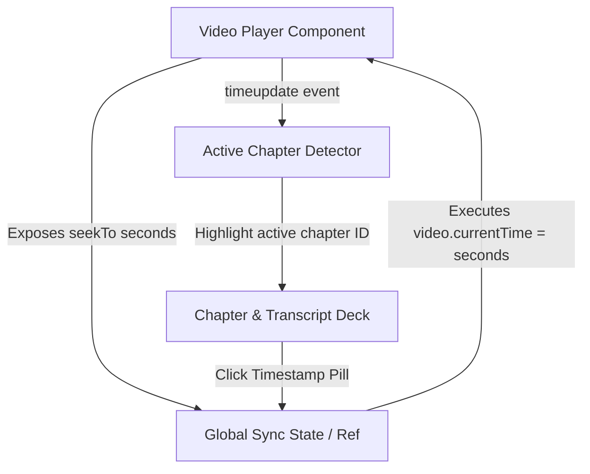

# SummAI Design System & Engineering Specification

**Version:** 1.0.0  
**Model Target:** `gemini-3.8-flash`  
**Engine:** Next.js 15+ (App Router), Tailwind CSS v3, `@google/genai` SDK  

---

## 1. Palette & Surface Depth Tokens

### Canvas & Surface Container Hierarchy
| Token Name | Hex / RGBA | Role / Usage |
| :--- | :--- | :--- |
| `background` / `surface` | `#0f131c` | Deep obsidian base foundation canvas across viewport |
| `surface-dim` | `#0f131c` | Recessed viewport backing |
| `surface-container-lowest` | `#0a0e17` | Deepest inset well (timeline tracks, code blocks) |
| `surface-container-low` | `#181b25` | Base card and inactive panel background |
| `surface-container` | `#1c1f29` | Primary elevated workspace panel, player shell |
| `surface-container-high` | `#262a34` | Hovered cards, active chapter items, popovers |
| `surface-container-highest`| `#31353f` | Elevated modals, tooltips, dialogs |
| `surface-bright` | `#353943` | High-contrast highlight surfaces |

### Content & Boundary Tokens
| Token Name | Hex / RGBA | Role / Usage |
| :--- | :--- | :--- |
| `on-surface` | `#dfe2ef` | Primary high-contrast text and icons |
| `on-surface-variant` | `#c7c4d7` | Secondary text, descriptions, captions |
| `outline` | `#908fa0` | Distinct divider borders, active strokes |
| `outline-variant` | `#464554` | 1px subtle frosted border (`rgba(255,255,255,0.08)`) |

### Action & Telemetry Tokens
| Token Name | Hex / RGBA | Role / Usage |
| :--- | :--- | :--- |
| `primary` | `#c0c1ff` | Light indigo accent, highlighted text |
| `primary-action` | `#6366f1` | Primary action button, active scrub bar fill, active rings |
| `secondary` | `#4edea3` | Telemetry light accent, active chapter label |
| `secondary-action` | `#10b981` | Emerald telemetry metrics, interactive timestamp pills |
| `secondary-container` | `#00a572` | Deep emerald fill for badges and active pills |
| `tertiary` | `#d0bcff` | Light violet/tertiary accent |
| `tertiary-action` | `#8b5cf6` | Violet secondary interactive triggers |

### Typography Scale
- **Headline**: `Geist`, `sans-serif`
- **Body**: `Inter`, `sans-serif`
- **Mono**: `JetBrains Mono`, `monospace`

---

## 2. Split-Pane Sync Architecture



### Player Interface Contract
```typescript
export interface VideoPlayerHandle {
  seekTo: (seconds: number, autoplay?: boolean) => void;
  play: () => void;
  pause: () => void;
  getCurrentTime: () => number;
  getDuration: () => number;
}
```

### Split-Pane Layout
- **Left Stage (60% on desktop)**:
  - Video viewport with 16:9 aspect ratio preservation (HTML5 Video & YouTube embed support).
  - Custom scrub bar with embedded chapter tick markers.
  - Precision time display (`00:00 / 00:00`), speed control, volume scrub, and jump controls (-10s / +10s).
  - Telemetry drawer: Latency, tokens, dynamic frame rate indicator (`Agentic 3.8 Flash`).
- **Right Intelligence Deck (40% on desktop)**:
  - Header: Video summary header + export options (Markdown, JSON).
  - Tabs:
    1. **Chapters**: Interactive list with timestamp pills (`#10b981`) that trigger `seekTo(seconds)`.
    2. **Executive Summary**: Key takeaways and high-impact takeaways.
    3. **Action Items**: Timestamped decisions and assigned tasks.
    4. **Transcript**: Searchable verbatim transcript with sync highlights.
    5. **AI Chat/Q&A**: Video grounding Q&A grounded in chapter markers.

---

## 3. Gemini 3.8 Flash API Pipeline

### Model & Configuration
- **Model**: `gemini-3.8-flash`
- **SDK**: `@google/genai` (`new GoogleGenAI({ apiKey })`)
- **Mode**: Agentic Video Understanding (timeline navigation, adaptive frame inspection, structured chaptering).
- **Fallback / Mock Mode**: High-fidelity pre-computed intelligent samples available instantly if no API key is provided, guaranteeing instant demo capability.
- **Output Schema**: Strict JSON generation using `responseSchema` with:
  - `title`, `durationStr`, `durationSeconds`
  - `executiveSummary` (markdown supported)
  - `keyTakeaways` (array of strings)
  - `chapters`: array of `{ id, title, startSeconds, endSeconds, timestampStr, summary, keyPoints }`
  - `actionItems`: array of `{ id, task, timestampSeconds, timestampStr, priority }`
  - `transcript`: array of `{ id, startSeconds, endSeconds, timestampStr, speaker, text }`
  - `telemetry`: `{ totalTokens, processingTimeMs, efficiencyGain, modelName }`
